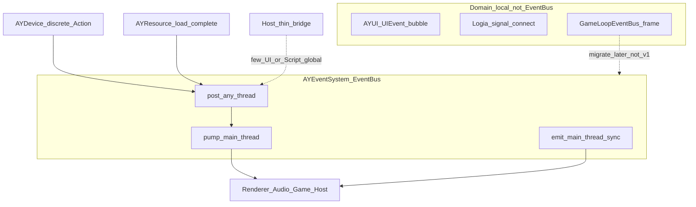
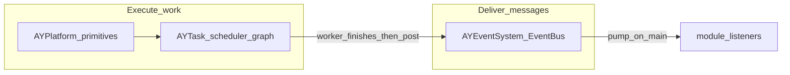

# AYEventSystem Design

**Path**: `D:\Projects\AYRuntime\AYEventSystem\`  
**Status**: Design locked (industrial direction) — Phase 1 implementation pending  
**Supersedes**: earlier feature-list draft in this file; rejects AliyatRenderer `Core/EventSystem` architecture

---

## 1. Goals / Non-Goals / Anti-Goals

### 1.1 Goals

- **Cross-module decoupling**: typed publish/subscribe between engine modules (Device, Resource, Renderer, Audio, Host, …).
- **Thread-safe posting**: any thread may `post` work into the bus.
- **Main-thread dispatch**: listeners always run on the designated main (game) thread via `pump` / synchronous `emit`.
- **Stable subscription lifetime**: opaque connection tokens + RAII `ScopedConnection`; unsubscribe never compares `std::function` targets.
- **Predictable queue semantics**: optional coalesce by type+key; default is no merge / no silent drop.
- **Clear boundaries**: EventBus is not a job system, not UI bubble, not Script component signals.

### 1.2 Non-Goals (v1)

- Absorbing `GameLoopEventBus` frame events.
- Replacing AYUI internal `UIEvent` bubbling / EventBridge.
- Logia global `event.emit` / `event.subscribe` (INT-04) — bridge later.
- Per-layer thread pools or task-graph scheduling inside the bus.
- Zero-heap-allocation SLA.
- String-keyed core dispatch path.
- Full catalog of every engine event type on day one.

### 1.3 Anti-Goals (lessons from AliyatRenderer)

Do **not** reintroduce these patterns from
`AliyatRenderer/src/Core/EventSystem/`:

| Anti-pattern | Why it fails |
|--------------|--------------|
| `EventLayer` × per-layer `ThreadPool`; handlers run on workers | UI / render / game state are not thread-safe; races and undefined order |
| `update()` enqueues to pools without joining | Handlers outlive the frame; next frame races with previous work |
| String `event_name` subscribe + `std::function::target` unsubscribe | No compile-time safety; lambdas/`bind` almost never unsubscribe correctly |
| Raw `new EventToken` while pool `subscribe` returns `nullptr` | Ownership unclear; leaks |
| Global pending `set` + `shouldMerge` + `MAX_CACHED_EVENTS` drop | Merge semantics vague; drops unpredictable; priority comparator fragile |
| String `EventRegistry` factory + static `REGISTER_*` | Static init order; payload mutated after create |
| Bus doubles as “layer scheduler” | Incomplete job graph fighting a real thread/job system |

---

## 2. Architecture and thread contract

### 2.1 Role

EventBus is the **engine-wide deferred + sync typed bus** for cross-module notifications.
Domain-local event surfaces stay local.



**On the bus**: cross-module, deferrable, possibly posted from worker threads  
(e.g. resource ready, window resize, discrete input actions, network session state).

**Off the bus**: per-frame mouse move, UI hit-test bubble, Script per-component `emit`,
render submit hot paths.

### 2.2 Thread contract (normative)

| API | Allowed threads | Listener runs on |
|-----|-----------------|------------------|
| `post<T>` / `post_coalesce<T>` | Any | Main, during next `pump` |
| `pump` / `dispatch` | Main only | Main |
| `emit<T>` | Main only | Main (immediate) |
| `subscribe` / `unsubscribe` | Main preferred; if called off-main must be externally synchronized with pump | n/a |

Debug builds: assert main-thread identity on `emit` / `pump`.

**Need parallelism?** A listener may enqueue work into `AYThread` / a job system.
The EventBus itself never binds handlers to layer-specific thread pools.

### 2.3 Engine frame placement

Recommended host order (illustrative):

1. Device poll → discrete actions may `post` or `emit`
2. `EventBus::pump()` — drain deferred queue before simulation/UI that depends on it
3. GameLoop / simulation
4. UI update / render

Exact ordering is host-owned; the bus only requires a single main-thread `pump` per frame (or more if the host chooses).

---

## 3. Core API (spec-level)

Namespace: `ayt::event` (implementation may adjust; keep one public umbrella header).

### 3.1 Priority (queue drain only)

```cpp
enum class EventPriority : uint8_t {
    Critical = 0,  // drain first (e.g. shutdown / fatal)
    High     = 1,  // window / discrete input actions
    Normal   = 2,  // gameplay / audio cues
    Low      = 3,  // resource / background notifications
    Count
};
```

- Priority affects **`post` queue drain order inside `pump` only**.
- Synchronous `emit` ignores queue priority (runs immediately).
- Listener registration order defines call order for the same type.
- Do **not** mix “listener priority” into the same enum; if ever needed, it is a separate subscribe option in a later phase.

### 3.2 Event type identity

Each event type provides a stable compile-time id. Preferred v1 pattern:

```cpp
using EventTypeId = uint32_t;

struct WindowResizeEvent {
    static constexpr EventTypeId kTypeId = 0x0001'0001; // hand-assigned ranges per module
    static constexpr EventPriority kPriority = EventPriority::High;

    int width = 0;
    int height = 0;
};
```

Rules:

- **No** `reinterpret_cast` of a static local address as `constexpr` type id.
- Optional later: `EventBus::registerType<T>()` assigning an atomic counter for types without hand ids — still stored on the **bus instance**, not in a process-wide `static` listener vector.
- Events used with `post` must be **owning / copyable** (no dangling `string_view` into caller stack). Prefer POD / fixed buffers / ids over `std::string`.

### 3.3 Connection

```cpp
using ConnectionId = uint64_t; // 0 = invalid

class EventBus {
public:
    template<typename TEvent>
    ConnectionId subscribe(std::function<void(const TEvent&)> handler);

    void unsubscribe(ConnectionId id); // type-erased; id unique across all types

    // ...
};

class ScopedConnection {
public:
    ScopedConnection() = default;
    ScopedConnection(EventBus& bus, ConnectionId id);
    ScopedConnection(ScopedConnection&& other) noexcept;
    ScopedConnection& operator=(ScopedConnection&& other) noexcept;
    ~ScopedConnection(); // calls unsubscribe if valid

    ScopedConnection(const ScopedConnection&) = delete;
    ScopedConnection& operator=(const ScopedConnection&) = delete;

    void reset();
    ConnectionId id() const;
    explicit operator bool() const;
};
```

Unsubscribe **must not** compare `std::function` targets (AliyatRenderer failure mode).

### 3.4 Publish

```cpp
class EventBus {
public:
    // Synchronous — main thread only. Invokes current listeners for T immediately.
    template<typename TEvent>
    void emit(const TEvent& event);

    template<typename TEvent, typename... Args>
    void emit(Args&&... args); // constructs TEvent then emit

    // Deferred — any thread. Copied/moved into the queue; delivered on pump.
    template<typename TEvent>
    void post(TEvent event);

    template<typename TEvent, typename... Args>
    void post(Args&&... args);

    // Optional coalesce: same TEvent + key replaces any pending post with that key.
    template<typename TEvent>
    void post_coalesce(uint64_t key, TEvent event);

    // Drain deferred queues by EventPriority Critical→Low; main thread only.
    void pump();
};
```

### 3.5 Reentrancy

During `emit` / `pump` delivery:

- `subscribe` / `unsubscribe` must not invalidate the in-flight listener iteration.
- Implementation: snapshot listener list **or** defer add/remove until the current delivery finishes.
- `emit`/`post` from inside a listener is allowed; nested `emit` is sync; `post` is queued for current or next pump (define: posts during pump are drained in the **same** `pump` call until queues empty, with a safety iteration cap in debug).

### 3.6 Instance model

```cpp
class EventBus {
public:
    static EventBus& instance(); // process default; tests may construct local EventBus

    EventBus();
    ~EventBus();

    EventBus(const EventBus&) = delete;
    EventBus& operator=(const EventBus&) = delete;
};
```

Listener tables and queues live on the **instance**, never as function-local `static std::vector` keyed only by `T`.

---

## 4. Priority vs coalesce (do not conflate)

### 4.1 Priority

- Property of the **event type** (default) or overridden at `post` time if an overload is added later.
- Orders drain buckets inside `pump`.
- Does not choose a thread.

### 4.2 Coalesce

- Default: **no coalesce** — every `post` is delivered.
- `post_coalesce(key, event)`: among pending items of type `T` with the same `key`, keep only the latest (overwrite payload / replace node).
- Typical keys: `0` for singleton types (`WindowResizeEvent`), or resource id for progress events.
- No virtual `merge(const IEvent&)` on a polymorphic base as the default path.

---

## 5. Split: Platform vs Task vs Event (normative)

The old monolithic “AYThread + EventSystem runs handlers on layer pools” idea is **split**:

| Layer | Module | Owns |
|-------|--------|------|
| Thread primitives | [`AYFoundation/AYPlatform`](../AYFoundation/AYPlatform) | `Thread`, `Mutex`, `Semaphore`, atomics, TLS — **not** a job queue |
| Job / task execution | [`AYFoundation/AYTask`](../AYFoundation/AYTask) | `TaskScheduler` (work-stealing pool), `TaskGraph`, `FlowGraph`, `ITask` |
| Cross-module messages | **this module (`AYEventSystem`)** | typed `post` / `pump` / `emit`; listeners on **main thread only** |

Root `design.md` historically listed a standalone `AYThread` project. That responsibility is **not** a separate runtime tree today:

- primitives → **AYPlatform**
- scheduling / DAG → **AYTask**



**Contract between AYTask and AYEventSystem:**

1. Heavy / parallel work → `AYTask` (`submit` / `TaskGraph::execute`).
2. When results must reach game/UI/renderer state → worker (or completing task) calls `EventBus::post(...)`.
3. Main loop calls `EventBus::pump()`; listeners mutate engine state on the main thread.
4. EventBus **never** submits to AYTask on behalf of a priority/layer. A listener may call into AYTask if it needs more work.

## 6. Module boundaries

| Module | Relationship |
|--------|----------------|
| **AYUI** | Keeps internal `UIEvent` + EventBridge. Host may `post` a few game-facing events (e.g. “pause menu requested”). High-frequency pointer streaming stays off the bus. |
| **AYScript** | Per-component `signal` / `emit` / `connect` (S4.1) stay local. Global `event.*` (INT-04) bridges onto EventBus in a later phase. |
| **AYGameLoop** | See §6.1 — `GameLoopEventBus` is an **interim** typed sync bus; target is AYEventSystem. |
| **AYDevice** | Prefer posting **discrete** actions / button edges; continuous axes/mouse deltas stay in the input → UI/game direct path. |
| **AYResource** | Worker finish → `post(ResourceLoadCompleteEvent{...})` → main `pump` notifies dependents. |
| **AYPlatform** | Thread primitives only; no event dispatch. |
| **AYTask** | Job execution only; completion notifies via EventBus `post` (see §5). |

### 6.1 GameLoopEventBus — interim, replace with AYEventSystem

[`AYGameLoop` `GameLoopEventBus`](../AYGameLoop/include/GameLoopEventBus.h) is **not** the long-term engine event hub.

| | |
|--|--|
| **Today** | Local typed sync observer for frame lifecycle (`LogicFrameStart/End`, `RenderFrameStart/End`, …). Already used by GameLoop so the loop is not blocked on AYEventSystem Phase 1. |
| **Intent** | **Placeholder / staging bus.** Once AYEventSystem Phase 1 ships, migrate these emissions to `ayt::event::EventBus` (`emit` on main for same-frame lifecycle, or `post`+`pump` if deferred is preferred). |
| **End state** | Remove or thin-wrap `GameLoopEventBus` (facade that forwards to AYEventSystem). Call sites should not grow new permanent APIs on `GameLoopEventBus`. |
| **v1 coding rule** | New cross-module notifications go to AYEventSystem design; do not add unrelated event types to `GameLoopEventBus`. |

Migration can be incremental: keep event **payload structs**, swap the bus implementation underneath.

---

## 7. Directory layout

```
AYRuntime/AYEventSystem/
├── design.md                 # this document (source of truth)
├── CMakeLists.txt            # Phase 1+
├── include/
│   └── ayevent/
│       ├── EventBus.h
│       ├── EventPriority.h
│       ├── Connection.h      # ConnectionId + ScopedConnection
│       └── Events/           # optional shared POD events (grow over time)
│           └── WindowEvents.h
└── unittest/
    └── Test_EventBus.cpp
```

No `ECEventDependence` layer enum, no string `EventRegistry` in v1.

---

## 8. Implementation phases

### Phase 1 — Core bus (first code drop)

- [ ] `EventPriority`, `ConnectionId`, `ScopedConnection`
- [ ] `EventBus` instance with per-type listener maps on the instance
- [ ] `subscribe` / `unsubscribe` / `emit` / `post` / `pump`
- [ ] Reentrancy-safe listener mutation
- [ ] Debug main-thread asserts on `emit` / `pump`
- [ ] AYTest coverage (see §8)
- [ ] CMake target + wire into AYRuntime solution as needed

**Out of Phase 1**: object pool, Script string bridge, GameLoop absorption, Device/UI production wiring, coalesce (optional stretch if cheap).

### Phase 2 — Queue hardening

- [ ] `post_coalesce`
- [ ] Optional event / packet pool (reduce alloc churn; still no “zero alloc” claim)
- [ ] Basic counters (posted / delivered / peak queue depth) for diagnostics

### Phase 3 — Bridges

- [ ] Optional string alias table for Script INT-04
- [ ] Migrate `GameLoopEventBus` → AYEventSystem (facade or delete); update AYGameLoop call sites
- [ ] Thin host examples (Device action → bus, Resource complete → bus, AYTask completion → `post`)

---

## 9. Test matrix (Phase 1+)

| Case | Expectation |
|------|-------------|
| `subscribe` + `emit` | Handler called once with payload |
| `unsubscribe` / `ScopedConnection` dtor | No further calls |
| `emit` during handler `unsubscribe` self | No crash; current delivery well-defined |
| `subscribe` during `emit` | New handler not called for current event (or documented snapshot rule) |
| `post` then `pump` | Handler runs on pump, not before |
| Multiple priorities queued | Drain Critical → High → Normal → Low |
| Cross-thread `post` + main `pump` | All events delivered; no data race under TSan if available |
| Debug: `emit`/`pump` off main | Assert / fail test helper |
| `post_coalesce` (Phase 2) | Same key → single delivery of latest payload |

---

## 10. Relation to older drafts

| Source | Disposition |
|--------|-------------|
| Previous content of this `design.md` (typed emit + pool + 4 priorities) | Keep typed sync/deferred idea; drop static listeners, fake constexpr type ids, zero-alloc SLA, listener-priority confusion |
| Root `Projects/design.md` §3.4 (8 layers, Registry, path `D:\Projects\AYEventSystem\`) | Superseded by this doc; index updated to `AYRuntime/AYEventSystem` |
| AliyatRenderer `EventSystem` | Reference for Anti-Goals only — not a port target |

---

## 11. References (ideas, not ports)

- Godot Signals — local typed connections; not a global job queue
- EnTT dispatcher — typed sync patterns
- Unreal: Game Thread / Task Graph separation — events vs tasks
- Existing in-repo: `AYRuntime/AYGameLoop` `GameLoopEventBus` (typed sync; migrate later)
